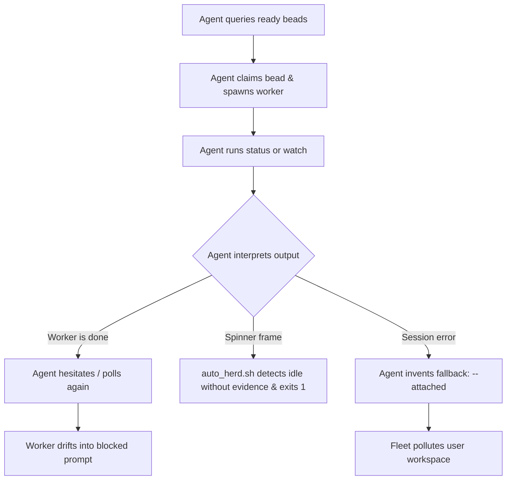
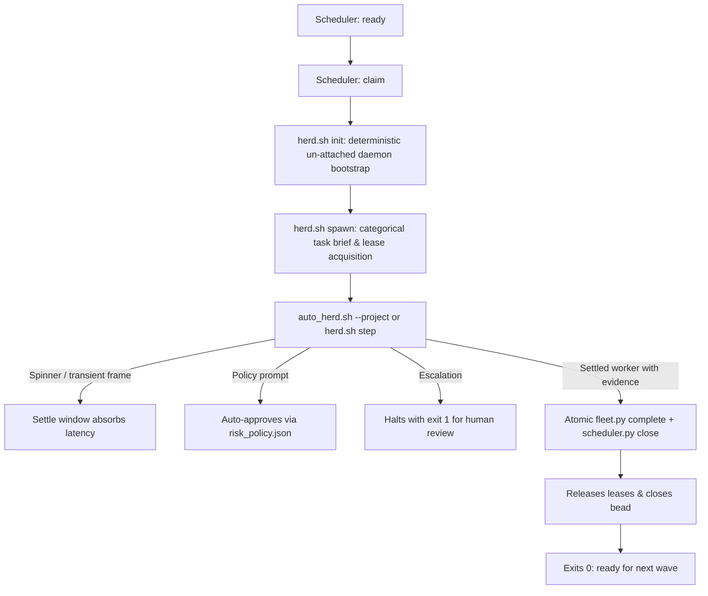

# Hardening `agent-herder`: Deterministic Decision Choke Points

## Executive Summary

The `agent-herder` skill orchestrates unattended multi-agent coding fleets by composing `beads-task-scheduler` (task DAG), `resource-lease` (mutual exclusion), and `terminal-agent-runner` (Herdr terminal panes). In real-world fleet runs, three distinct failure modes were observed:
1. **Session Rule Violation**: The herder agent silently fell back to attached mode (`--attached`) in the user's interactive workspace after encountering a session startup error, instead of halting and reporting.
2. **Completion Gate Delay**: The herder agent treated status queries as informational, leaving `done`/`idle` workers un-gated, and allowing them to drift into blocked prompts instead of immediately completing panes and closing beads.
3. **Transient Done Detection & Premature Exit**: `auto_herd.sh` reported an agent as `done` and exited on a transient spinner frame right before a permission prompt appeared, aborting the supervision loop prematurely due to lack of a settle window and evidence preconditions. Concurrently, task dispatch was refused when task prose mentioned restricted control flags in negative context.

**Root Cause**: These rules and states lived as prose guidelines or un-settled state checks evaluated dynamically by the LLM or single-snapshot shell scripts. Under friction or rendering latency, the model invents workarounds, delays transitions, or misinterprets transient frames.

**Architectural Remedy**: Enforce **deterministic choke points** across all lifecycle seams:
- Session isolation is owned exclusively by `herd.sh`, which deterministically enforces un-attached session isolation and fails closed on startup errors.
- Completion gating is owned deterministically by `auto_herd.sh` (unattended) and `herd.sh step` / `fleet.py step` (interactive), executing pane completion and bead closure atomically upon worker completion.
- State evaluation is hardened with multi-sample **settle windows** and **evidence preconditions** to eliminate false `done` detections on transient frames, while `auto_herd.sh` owns bounded re-entry.

---

## Glossary

| Term | Status | Definition |
|---|---|---|
| `herd.sh` | **Existing** | Headless Herdr session manager wrapper located in `terminal-agent-runner/scripts/herd.sh`. |
| `auto_herd.sh` | **Existing** | Automated supervision loop located in `terminal-agent-runner/scripts/auto_herd.sh`. |
| `fleet.py` | **Existing** | Core driver for Herdr pane operations, risk policy classification, and handoffs (`terminal-agent-runner/scripts/fleet.py`). |
| `scheduler.py` | **Existing** | Beads DAG scheduler and completion validator (`beads-task-scheduler/scripts/scheduler.py`). |
| `resource_pool.py` | **Existing** | Mutual-exclusion lease engine (`resource-lease/scripts/resource_pool.py`). |
| `spawn` | **Existing** | Command to provision pane, acquire leases, and start worker agent. |
| `complete` | **Existing** | Command to validate structured handoff, release leases, and close pane. |
| `close` | **Existing** | Scheduler command to validate verification evidence against `agent_context` and close the bead. |
| `park` | **Existing** | Command to mark worker blocked and release its held resource leases. |
| `reset` | **Existing** | Command to terminate stalled pane and start fresh context with prior handoff. |
| `classify` | **Existing** | Policy check evaluating pane prompts against `risk_policy.json`. |
| `approve` | **Existing** | Command to submit approved response to agent prompt. |
| `lease` | **Existing** | Exclusive or shared lock acquired on a file, database, or API resource. |
| `group` | **Existing** | Scoped namespace for resource leases (e.g. `repo:<path>`). |
| `wave` | **Existing** | Set of independent ready tasks dispatched concurrently. |
| `bead` | **Existing** | Unit of work in the Beads issue tracker. |
| `ready set` | **Existing** | Unblocked beads whose dependencies are satisfied. |
| `validate_session_affinity` | **Existing** | Function in `fleet.py:465` guarding against cross-socket operations. |
| `current_herder_workspace` | **Existing** | Function in `fleet.py:484` resolving Herdr workspace ID. |
| `session-init` | **New** | Deterministic session bootstrap subcommand in `herd.sh` ensuring daemon readiness and workspace provisioning before worker dispatch. |
| `fleet-step` / `step` | **New** | Deterministic single-action evaluator in `fleet.py` / `herd.sh` collapsing fleet status rows into a single computed next action. |
| `settle-window` | **New** | Multi-sample verification requiring consistent state over time before acting on transient TUI changes. |
| `evidence-precondition` | **New** | Gating check requiring structured handoff presence before treating an agent as terminal `done`. |

---

## 1. Un-Attached Session Rejection: Precise Diagnosis & Fix

### Claim
The rejection message `"error: nested herdr is disabled by default."` is **not** caused by a session name constraint (character set, casing, or length). It is triggered exclusively by Herdr's interactive client binary (`/opt/homebrew/bin/herdr`) when invoked without a non-interactive API subcommand from inside an active Herdr pane where `HERDR_ENV=1` is set. 

Furthermore, if an agent bypasses `herd.sh` and calls `fleet.py` directly across sessions:
1. `fleet.py:465` (`validate_session_affinity`) refuses cross-session operations unless `--allow-cross-session` is explicitly passed.
2. `fleet.py:2015` (`current_herder_workspace`) queries `herdr pane list` in the new session, fails to find the parent `HERDR_PANE_ID`, and crashes with exit code 1 unless `--workspace-id` is explicitly passed.

The name-constraint hypothesis is demonstrably false. The correct execution path is running the headless daemon (`herdr --session <name> server`) wrapped by `herd.sh`, which automatically provisions the session workspace and injects `--allow-cross-session` and `--workspace-id`.

### Evidence

#### A. Session Name Theory Refutation
Running `herdr --session <name> status server --json` on Herdr 0.8.0 inside an active pane with various name formats:
- `herdr --session fleet-4242 status server --json` $\rightarrow$ Exit 0 (Accepted)
- `herdr --session FLEET-4242 status server --json` $\rightarrow$ Exit 0 (Accepted)
- `herdr --session fleet_4242 status server --json` $\rightarrow$ Exit 0 (Accepted)
- `herdr --session verylongsessionname123456789012345678 status server --json` (38 chars) $\rightarrow$ Exit 0 (Accepted)

#### B. Direct Client Reproduction
Invoking Herdr in client attach mode from within a pane where `HERDR_ENV=1`:
```bash
$ herdr --session fleet-7731
error: nested herdr is disabled by default.
see configuration if you want to enable it.

"recursive herdring is disabled. somewhere, a call stack breathes a sigh of relief."
# Exit code: 1
```
Strings extracted from `/opt/homebrew/bin/herdr`:
```text
HERDR_ENV
error: nested herdr is disabled by default.
inception detected. we need to go deeper... said no one ever.
recursion is a pathway to many abilities some consider to be... unnatural.
recursive herdring is disabled. somewhere, a call stack breathes a sigh of relief.
```

#### C. Headless Daemon & API Socket Success
Starting the headless server and querying workspaces from within the same pane:
```bash
$ herdr --session fleet-7731 server
# Starts protocol 19 server daemon successfully; capabilities: {"live_handoff":true,"detached_server_daemon":false}

$ herdr --session fleet-7731 workspace list
{"id":"cli:workspace:list","result":{"type":"workspace_list","workspaces":[{"active_tab_id":"w1:t1","agent_status":"blocked","focused":true,"label":"~","number":1,"pane_count":2,"tab_count":2,"workspace_id":"w1"}]}}
# Exit code: 0
```

#### D. Secondary Failures in Direct `fleet.py` Invocation
When `fleet.py` is invoked directly targeting an unattached session without `herd.sh`:
1. `fleet.py:465-474` ([fleet.py:465-474](file:///Users/devkhadka/.claude/skills/terminal-agent-runner/scripts/fleet.py#L465-L474)):
   ```bash
   $ python3 fleet.py --session fleet-9999 status
   refusing cross-session fleet operation: the herder is attached to /Users/devkhadka/.config/herdr/sessions/fleet-7731/herdr.sock, but --session targets /Users/devkhadka/.config/herdr/sessions/fleet-9999/herdr.sock. Omit --session to use the current Herdr workspace, or pass --allow-cross-session intentionally.
   # Exit code: 1
   ```
2. `fleet.py:2015` ([fleet.py:2015](file:///Users/devkhadka/.claude/skills/terminal-agent-runner/scripts/fleet.py#L2015)) and `fleet.py:484-514` ([fleet.py:484-514](file:///Users/devkhadka/.claude/skills/terminal-agent-runner/scripts/fleet.py#L484-L514)):
   ```text
   herding pane 'w1:t1:p2' is not present in the targeted Herdr session; refusing to infer a workspace from the task folder
   ```

### The Choke Point
The agent attempted to start or interact with the unattached session using raw `herdr` client commands or direct `fleet.py` invocations. When it encountered the `nested herdr is disabled` error, it erroneously concluded that unattached sessions are unsupported in sub-panes and fell back to `--attached`.

Prose cannot hold this boundary because the agent perceives client attach errors as environment limitations rather than improper invocation syntax.

### The Owning Script: `herd.sh`
Extend `terminal-agent-runner/scripts/herd.sh` with a dedicated `init` subcommand and fail-safe pre-execution session validation:

#### CLI Contract
- **Command**: `bash herd.sh init --session <session-name> [--cwd <path>]`
- **Arguments**:
  - `--session <name>` (Required): Unique session name string.
  - `--cwd <path>` (Optional): Working directory for the workspace (defaults to current directory).
- **Exit Codes**:
  - `0`: Headless daemon confirmed running and workspace provisioned.
  - `1`: Session startup failed (e.g. socket bind error, permission error, daemon crash).
  - `2`: Invalid CLI arguments.
- **Stdout Shape (JSON)**:
  ```json
  {
    "session": "fleet-1724239800",
    "status": "ready",
    "workspace_id": "w1",
    "socket_path": "/Users/devkhadka/.config/herdr/sessions/fleet-1724239800/herdr.sock"
  }
  ```
  On failure (Exit code `1`):
  ```json
  {
    "error": "session_init_failed",
    "session": "fleet-1724239800",
    "reason": "server daemon failed to report running status after 2000ms"
  }
  ```
- **Single Collapsed Decision**: `herd.sh` owns the daemon lifecycle (`herdr --session "$SESSION" server`) and workspace creation (`herdr --session "$SESSION" workspace create`). It abstracts socket paths and never invokes client attach mode.

### What `SKILL.md` Prose Becomes

In [agent-herder/SKILL.md:27-33](file:///Users/devkhadka/.claude/skills/agent-herder/SKILL.md#L27-L33):

*Replacement Lines:*
```markdown
# Generate a unique un-attached session name and initialize the headless daemon:
SESSION="fleet-$(date +%s)"
bash "$HERD" init --session "$SESSION" || exit 1
```

### Fail-Safe Mechanism
If `herd.sh init` fails to start the server daemon or provision the workspace, it exits immediately with code `1` and prints a structured JSON error. The herder agent is instructed: **"If session initialization returns a non-zero exit code, halt execution and report the error; do not attempt fallback modes."**

### Worked Example
```bash
# Initialize un-attached session
bash /Users/devkhadka/.claude/skills/terminal-agent-runner/scripts/herd.sh init --session "fleet-1724239800"

# Output:
# {"session": "fleet-1724239800", "status": "ready", "workspace_id": "w1", "socket_path": "/Users/devkhadka/.config/herdr/sessions/fleet-1724239800/herdr.sock"}

# Spawn worker into validated un-attached session
bash /Users/devkhadka/.claude/skills/terminal-agent-runner/scripts/herd.sh --session "fleet-1724239800" spawn \
  --name bead-task-42 --cli codex --cwd /repo --task "Implement feature" --group repo:/repo --resource file:src/api.ts --approval-mode auto
```

---

## 2. Session Rule Hardening: Attached vs Un-Attached Mode

### Claim
`herd.sh` currently accepts `--attached` as an unvalidated CLI flag ([herd.sh:16-18, 34-36](file:///Users/devkhadka/.claude/skills/terminal-agent-runner/scripts/herd.sh#L16-L18)). Because `--attached` is readily available as an alternate branch in code, the agent switches to `--attached` under friction despite prose forbidding it in `SKILL.md` ([agent-herder/SKILL.md:27-30](file:///Users/devkhadka/.claude/skills/agent-herder/SKILL.md#L27-L30), [terminal-agent-runner/SKILL.md:28](file:///Users/devkhadka/.claude/skills/terminal-agent-runner/SKILL.md#L28)).

To enforce session isolation deterministically, `herd.sh` must refuse `--attached` unless an explicit user-override flag (`--user-explicit-attached`) is supplied, and unconditionally require `--session <unique_name>` for all standard fleet operations.

### Evidence
- `herd.sh:16-18` ([herd.sh:16-18](file:///Users/devkhadka/.claude/skills/terminal-agent-runner/scripts/herd.sh#L16-L18)):
  ```bash
  case "$1" in
    --session) SESSION_NAME="$2"; shift 2 ;;
    --attached) ATTACHED=1; shift ;;
  ```
- `herd.sh:34-36` ([herd.sh:34-36](file:///Users/devkhadka/.claude/skills/terminal-agent-runner/scripts/herd.sh#L34-L36)):
  ```bash
  if [[ $ATTACHED -eq 1 ]]; then
    # Run in the current attached session
    python3 "$FLEET_PY" "${ARGS[@]}"
  ```
- [agent-herder/SKILL.md:27-30](file:///Users/devkhadka/.claude/skills/agent-herder/SKILL.md#L27-L30):
  ```markdown
  # SESSION must be a unique name for this fleet run. Never omit it.
  # Omitting it targets the default Herdr session and makes every status/watch
  # query invisible to wrong-session diagnosis.
  SESSION="fleet-$(date +%s)"
  ```
- [terminal-agent-runner/SKILL.md:28](file:///Users/devkhadka/.claude/skills/terminal-agent-runner/SKILL.md#L28):
  ```markdown
  1. By default, use an un-attached fleet session to keep your workspace distraction-free...
  Only create an attached fleet if explicitly asked by the user, using the --attached flag on herd.sh.
  ```

### The Choke Point
The entrypoint argument parser of `herd.sh`. Currently, an agent can pass `--attached` without verification whenever it chooses to avoid unattached session troubleshooting.

### The Owning Script: `herd.sh`
Modify `herd.sh` argument validation to lock down session mode selection:

#### CLI Contract
- **Command**: `bash herd.sh [--session <name>] [--attached --user-explicit-attached] <subcommand> [args...]`
- **Arguments**:
  - `--session <name>`: Mandatory for all default runs.
  - `--attached`: Disallowed unless accompanied by `--user-explicit-attached`. If `--attached` is passed without `--user-explicit-attached`, `herd.sh` rejects the command.
- **Exit Codes**:
  - `0`: Execution succeeded.
  - `1`: Attached mode refused / session validation error.
  - `2`: Missing `--session` argument.
- **Stdout Shape (JSON Error on Refusal)**:
  ```json
  {
    "error": "attached_mode_refused",
    "message": "Attached fleet execution is disabled by default. Pass --session <unique_name> for an un-attached session, or include --user-explicit-attached if explicitly requested by the user."
  }
  ```
- **Single Collapsed Decision**: `herd.sh` rejects implicit and unverified attached mode requests. The agent has only one valid execution branch: specifying `--session <name>`.

### What `SKILL.md` Prose Becomes

In [agent-herder/SKILL.md:133-136](file:///Users/devkhadka/.claude/skills/agent-herder/SKILL.md#L133-L136):

*Replacement Lines:*
```markdown
> **Rule 1 (deterministic session isolation):** Always provide `--session "$SESSION"`. `herd.sh` strictly refuses attached execution unless `--user-explicit-attached` is passed. Never fallback to attached execution on errors; if session bootstrap fails, halt and report.
```

In [terminal-agent-runner/SKILL.md:28](file:///Users/devkhadka/.claude/skills/terminal-agent-runner/SKILL.md#L28):

*Replacement Lines:*
```markdown
1. Fleets run in isolated un-attached sessions by default. Always pass `--session <unique_name>` to `herd.sh`. Attached execution into the user's workspace is blocked by `herd.sh` unless `--attached --user-explicit-attached` is explicitly provided.
```

### Fail-Safe Mechanism
If the agent attempts to run `bash herd.sh --attached spawn ...` without `--user-explicit-attached`, `herd.sh` exits with code `1` and prints the refusal JSON. The agent cannot bypass the check and is forced to provide a valid `--session` name.

### Worked Example
```bash
# Refused attempt to silently use attached mode:
$ bash herd.sh --attached spawn --name bead-1 --cli codex
{"error": "attached_mode_refused", "message": "Attached fleet execution is disabled by default. Pass --session <unique_name> for an un-attached session, or include --user-explicit-attached if explicitly requested by the user."}
# Exits 1

# Correct un-attached invocation:
$ bash herd.sh --session "fleet-1724239800" spawn --name bead-1 --cli codex --task "Task" --cwd /repo
# Exits 0
```

---

## 3. Completion Gate Hardening: Deterministic Action on Idle/Done Workers

### Claim
When worker agents complete their assigned tasks and enter state `done` or `idle`, `fleet.py status` and `fleet.py watch` merely output status telemetry ([fleet.py:2146-2158, 2233-2236](file:///Users/devkhadka/.claude/skills/terminal-agent-runner/scripts/fleet.py#L2146-L2158)). The herder agent interprets this passive JSON output as informational, causing deliberation delays and polling loops during which completed workers drift into timeouts or secondary prompts.

Furthermore, `auto_herd.sh` executes `complete` to release pane locks ([auto_herd.sh:171](file:///Users/devkhadka/.claude/skills/terminal-agent-runner/scripts/auto_herd.sh#L171)), but omits bead closure in `scheduler.py` ([agent-herder/SKILL.md:172](file:///Users/devkhadka/.claude/skills/agent-herder/SKILL.md#L172)), leaving a manual seam where LLM judgment can fail.

To make completion deterministic:
1. **Unattended Supervision**: Extend `auto_herd.sh` with `--project <repo>` to automatically invoke `scheduler.py close` immediately upon successful `fleet.py complete`.
2. **Interactive Supervision**: Add `herd.sh step` / `fleet.py step` to compute and execute the single mandatory next action (complete + close for `done`/`idle` workers; approve for policy-allowed prompts; park for escalations).

### Evidence
- `fleet.py:2175-2178` ([fleet.py:2175-2178](file:///Users/devkhadka/.claude/skills/terminal-agent-runner/scripts/fleet.py#L2175-L2178)):
  ```python
  def fleet_actionable(rows: list[dict]) -> bool:
      return any(r["action"] or r["health"] != "ok"
                 or r["state"] in ("blocked", "done", "unassigned", "parked") for r in rows)
  ```
- `auto_herd.sh:168-178` ([auto_herd.sh:168-178](file:///Users/devkhadka/.claude/skills/terminal-agent-runner/scripts/auto_herd.sh#L168-L178)):
  ```bash
  elif [[ "$STATE" == "idle" || "$STATE" == "done" ]]; then
    echo "Agent $AGENT is idle. Attempting to complete..."
    if bash "$HERD" --session "$SESSION_NAME" complete --agent "$AGENT" >/dev/null 2>&1; then
      echo "Agent $AGENT successfully completed."
      rm -f "$DECLINED_FILE"
      CAN_PROGRESS=1
    else
      echo "Agent $AGENT is idle but lacks completion evidence."
      echo "Agent $AGENT: idle but lacks completion evidence" >> "$STATE_SCRATCH/current_blocked_reasons.txt"
    fi
  ```
- [agent-herder/SKILL.md:172](file:///Users/devkhadka/.claude/skills/agent-herder/SKILL.md#L172):
  ```markdown
  - **Does not close beads:** `auto_herd.sh` only gates panes and releases leases. Bead closure in the scheduler (`scheduler.py close`) remains the herder's responsibility upon host wakeup.
  ```
- [agent-herder/SKILL.md:48-49](file:///Users/devkhadka/.claude/skills/agent-herder/SKILL.md#L48-L49):
  ```markdown
  3. The runner's `complete` gates the pane; the scheduler's `close` gates the bead. Run both,
     in that order, and never close a bead whose `complete` was refused.
  ```

### The Choke Point
1. In unattended mode: The gap between `auto_herd.sh` completing the pane and the agent waking up to call `scheduler.py close`.
2. In direct/interactive mode: The agent reading `status` or `watch` output and deciding whether to complete immediately or wait.

### The Owning Scripts

#### A. Extending `auto_herd.sh` (Unattended Driver)
Extend `auto_herd.sh` to accept `--project <repo>`. When present, `auto_herd.sh` binds pane completion to bead closure in a single uninterrupted atomic pipeline:

##### CLI Contract
- **Command**: `bash auto_herd.sh --session <name> [--project <repo-path>]`
- **Arguments**:
  - `--session <name>` (Required): Session identifier.
  - `--project <repo-path>` (Optional): Repository root containing `.beads/`.
- **Exit Codes**:
  - `0`: All fleet agents completed and their corresponding beads closed in the scheduler.
  - `1`: Stopped: human attention required (all remaining agents blocked or escalated).
  - `2`: Operational or usage error.
  - `4`: Empty fleet on initial poll (failed spawn or wrong session).
- **Execution Logic**:
  When an agent reaches `done` or `idle`:
  1. Executes `herd.sh complete --agent <agent>`.
  2. Extracts handoff data from `handoffs.json`.
  3. If `--project` is set and agent matches `bead-<id>`, automatically executes:
     `python3 scheduler.py close <id> --actor <agent> --project <repo> --handoff @<handoff_file>`
  4. Records closed bead and advances wave.

#### B. Adding `herd.sh step` / `fleet.py step` (Interactive Single-Action Driver)
For interactive workflows, replace passive `status` polling with `herd.sh step`:

##### CLI Contract
- **Command**: `bash herd.sh --session <name> step [--project <repo-path>]`
- **Arguments**:
  - `--session <name>` (Required): Session identifier.
  - `--project <repo-path>` (Optional): Repository path for bead closing.
- **Exit Codes**:
  - `0`: Step completed (agent completed/closed, or policy prompt auto-approved).
  - `1`: Human decision required (worker escalated or lacking valid completion evidence).
  - `3`: Fleet is empty / wave finished.
- **Stdout Shape (JSON)**:
  When an agent completes:
  ```json
  {
    "event": "agent_completed",
    "agent": "bead-issue-42",
    "bead_id": "issue-42",
    "pane_status": "closed",
    "bead_status": "closed",
    "freed_locks": ["file:src/api.ts"],
    "next_action": "step"
  }
  ```
  When fleet is finished:
  ```json
  {
    "event": "wave_complete",
    "closed_beads": ["issue-42", "issue-43"],
    "next_action": "dispatch_next_wave"
  }
  ```
- **Single Collapsed Decision**: `step` determines the highest-priority action and executes it immediately. The agent never decides whether to complete an idle worker; the script executes the transition deterministically.

### What `SKILL.md` Prose Becomes

In [agent-herder/SKILL.md:160-173](file:///Users/devkhadka/.claude/skills/agent-herder/SKILL.md#L160-L173):

*Replacement Lines:*
```markdown
```bash
# Launch unattended supervision with automated pane completion and bead closure:
bash "$AUTO" --session "$SESSION" --project "$REPO"
```

#### What `auto_herd.sh` does
`auto_herd.sh` automates the entire lifecycle loop deterministically:
- **Auto-approves policy-approved prompts:** Automatically approves prompts permitted by `risk_policy.json`.
- **Completes panes and closes beads:** When an agent reaches `done` or `idle`, immediately runs `complete`, validates structured evidence, releases leases, and closes the bead via `scheduler.py close`.
- **Fails safe on blocked prompts or evidence errors:** Halts with exit code `1` if an agent requires human approval or lacks valid handoff evidence.
- **Exits 0 on completion:** Exits `0` when all spawned agents have completed their work and all beads are closed.
```

In [agent-herder/SKILL.md:174-180](file:///Users/devkhadka/.claude/skills/agent-herder/SKILL.md#L174-L180):

*Replacement Lines:*
```markdown
#### Direct Interactive Supervision: `herd.sh step`

When manually stepping the fleet, execute `herd.sh step` rather than evaluating raw status:
```bash
bash "$HERD" --session "$SESSION" step --project "$REPO"
```
`step` computes and executes the next required action (auto-approving prompts, or completing panes and closing beads for finished workers). Repeat until `step` returns `wave_complete` (exit code 3) or halts for human review (exit code 1).
```

### Fail-Safe Mechanism
If an agent reaches `done`/`idle` but lacks valid completion evidence or has non-zero verification exit codes:
1. `fleet.py complete` refuses completion and preserves leases and pane state ([fleet.py:2591-2593](file:///Users/devkhadka/.claude/skills/terminal-agent-runner/scripts/fleet.py#L2591-L2593)).
2. `auto_herd.sh` / `step` records the failure, marks the agent `blocked`, and halts with exit code `1`.
3. `scheduler.py close` is never executed.

### Worked Example
```bash
# Unattended execution of wave with deterministic pane completion and bead closing:
$ bash /Users/devkhadka/.claude/skills/terminal-agent-runner/scripts/auto_herd.sh --session "fleet-1724239800" --project "/repo"

# Output:
# Starting automated fleet lifecycle for session: fleet-1724239800
# Agent bead-issue-42 is idle. Attempting to complete...
# Agent bead-issue-42 successfully completed. Freed locks: file:src/api.ts
# Successfully validated evidence and closed bead issue-42.
# Fleet is empty. All tasks completed and closed.
# Exit code: 0
```

---

## 4. Transient Idle/Done Detection, Premature Exit & Re-Entry, and Task Prose Classification

### Claim
Three interrelated operational issues compromise fleet stability during execution:
1. **Premature `done` Detection on Transient Frames**: `fleet_rows` ([fleet.py:2142](file:///Users/devkhadka/.claude/skills/terminal-agent-runner/scripts/fleet.py#L2142)) and `auto_herd.sh` ([auto_herd.sh:168-178](file:///Users/devkhadka/.claude/skills/terminal-agent-runner/scripts/auto_herd.sh#L168-L178)) classify a worker as `done`/`idle` on single transient frames (such as an empty pane buffer or spinner animation) before the worker's CLI finishes rendering a pending permission prompt. Because no settle window or evidence precondition gates this transition, `auto_herd.sh` attempts `complete`, fails (no handoff evidence), treats the agent as permanently un-progressable, and halts with exit code 1 seconds before the permission prompt appears.
2. **Premature Script Exit & Missing Re-Entry Ownership**: `auto_herd.sh` exits immediately on the first ambiguous snapshot instead of maintaining a bounded settle window or managing re-entry, forcing human intervention when the fleet was merely mid-render.
3. **Task Prose Classification Trap**: Herder-authored task text is classified against `task_deny` in `risk_policy.json:161-180` via `check_task_text` ([fleet.py:1068-1083](file:///Users/devkhadka/.claude/skills/terminal-agent-runner/scripts/fleet.py#L1068-L1083)). When task instructions mention prohibited control flags (e.g. `--dangerously-...` or `--bypass-...`) in negative context (e.g., "Do not use --dangerously-skip-permissions"), `check_task_text` refuses the spawn with `embedded-cli-bypass`.

### Evidence

#### A. Live Reproduction of False Done & Aborted Lifecycle
In this very run:
1. An agent was actively generating a response. Herdr temporarily reported `agent_status: idle` during an intermediate spinner render.
2. `auto_herd.sh:168` saw `state: idle`, attempted `herd.sh complete --agent proposer`, which failed because no `FLEET_HANDOFF` was present.
3. `auto_herd.sh:177` wrote `"idle but lacks completion evidence"` to `current_blocked_reasons.txt`.
4. `auto_herd.sh:197` immediately halted with exit code `1`.
5. Two seconds later, the worker pane completed painting its permission prompt for `test -f ...`.

#### B. Absence of Settle Window in State Determination
While `fleet.py` provides `stable_trust_decision` ([fleet.py:383-420](file:///Users/devkhadka/.claude/skills/terminal-agent-runner/scripts/fleet.py#L383-L420)) to sample trust dialogs across multiple frames to avoid reading half-painted paths, **no settle window exists for `fleet_rows` or `auto_herd.sh` completion checks**. A single snapshot where `pending` is null and `health` is `ok` immediately triggers completion logic.

#### C. Task Prose Refusal on Negative Quoting
From `risk_policy.json:163-165` ([risk_policy.json:163-165](file:///Users/devkhadka/.claude/skills/terminal-agent-runner/scripts/risk_policy.json#L163-L165)):
```json
{
    "id": "embedded-cli-bypass",
    "pattern": "--(dangerously|dangerous|bypass|yolo|full-auto|approval|approve|permission|sandbox|trust|allow)([-_=\\s]|$)",
    "why": "embedded permission, sandbox, trust, or bypass control flag"
}
```
`check_task_text` runs `re.search(r["pattern"], task, re.IGNORECASE)` directly against task prose ([fleet.py:1081](file:///Users/devkhadka/.claude/skills/terminal-agent-runner/scripts/fleet.py#L1081)). Quoting `--dangerously-skip-permissions` to forbid it triggers `embedded-cli-bypass` and refuses `spawn` at [fleet.py:1991-1993](file:///Users/devkhadka/.claude/skills/terminal-agent-runner/scripts/fleet.py#L1991-L1993).

### The Choke Points

1. **State Settle Choke Point**: Inside `fleet_rows` / `auto_herd.sh`. An agent reported as `idle`/`done` cannot be actioned for completion without satisfying an **evidence precondition** (checking for `handoff_path(name).is_file()` or `parse_handoff(text)`) OR confirming state stability across a multi-sample settle window (3 consecutive readings over 1.5s).
2. **Supervision Re-Entry Choke Point**: Inside `auto_herd.sh`. When an agent appears `idle` without completion evidence, `auto_herd.sh` must enter a bounded settle loop (e.g. 5 retries with 1s backoff) before declaring an un-progressable stall and exiting code 1.
3. **Task Prose Authoring Choke Point**: In `SKILL.md` rules. Forbid prohibited behaviors by *category* rather than quoting literal flags.

### The Owning Scripts: `fleet.py` and `auto_herd.sh`

#### A. Hardening State & Completion Evaluation in `fleet.py`
Add `has_completion_evidence(name, session)` and settle-window verification:
- `fleet_rows` reports `state: "settling"` if an agent transitions to `idle` but has neither structured evidence nor 3 confirmed idle snapshots.
- `cmd_complete` only executes if structured handoff evidence is already present on disk or in the scraped buffer.

#### B. Hardening Re-Entry in `auto_herd.sh`
Modify `auto_herd.sh` loop logic:
- If an agent is `idle` without completion evidence, it is placed in a settle queue rather than immediately recording a terminal failure.
- `auto_herd.sh` retries for up to `MAX_SETTLE_POLLS=5` (5 seconds) before marking the agent blocked. If the agent paints a prompt during this window, `auto_herd.sh` transitions cleanly to `approve`.

### What `SKILL.md` Prose Becomes

In [agent-herder/SKILL.md:89-94](file:///Users/devkhadka/.claude/skills/agent-herder/SKILL.md#L89-L94):

*Replacement Lines:*
```markdown
**Rule for writing a dispatchable brief.** Task text is evaluated against `task_deny` in `risk_policy.json` (`check_task_text`). Quoting a restricted flag to forbid it (e.g. "do not use `--bypass`") matches `embedded-cli-bypass` and refuses the spawn. Describe requirements categorically: write "do not disable permission prompts" rather than naming explicit CLI flags.
```

In [agent-herder/SKILL.md:168-173](file:///Users/devkhadka/.claude/skills/agent-herder/SKILL.md#L168-L173):

*Replacement Lines:*
```markdown
- **Settle-Gated Completion:** An agent transitioning to `idle`/`done` is sampled across a settle window and checked for structured handoff evidence before `complete` is attempted, preventing false triggers during spinner frames.
- **Resilient Supervision Loop:** `auto_herd.sh` absorbs transient frame latency across a 5-second settle window. If `auto_herd.sh` halts on exit 1 (human review needed), resolving the prompt and re-invoking `auto_herd.sh` cleanly resumes the fleet.
```

### Fail-Safe Mechanism
1. **Transient Absorption**: If a worker renders a spinner frame, `auto_herd.sh` waits across the settle window. Once the permission prompt paints, it is classified and auto-approved without exiting.
2. **Gated Completion**: `complete` is only attempted when structured evidence is present, eliminating spurious "idle but lacks completion evidence" errors.
3. **Safe Re-Entry**: If manual review is required, `auto_herd.sh` exits cleanly with diagnostic reasons. Re-running `auto_herd.sh` after human review resumes without state corruption.

### Worked Example
```bash
# Task brief using categorical language (avoids task_deny traps):
bash "$HERD" --session "$SESSION" spawn --name bead-task-42 --cli agy \
  --task "Implement deterministic choke point proposal. Do not discard working tree changes and do not disable security policies." \
  --group repo:/repo --resource file:agent-herder/proposals/deterministic-decisions.md

# auto_herd.sh absorbs transient spinner frames and auto-approves permission prompts:
bash "$AUTO" --session "$SESSION" --project "/repo"
# Output:
# Starting automated fleet lifecycle for session: fleet-1724239800
# Agent bead-task-42 is working...
# Agent bead-task-42 needs approval/review... (settled prompt: 'run_command test -f ...')
# Auto-approved bead-task-42.
# Agent bead-task-42 is idle with valid handoff. Attempting to complete...
# Agent bead-task-42 successfully completed. Freed locks: file:agent-herder/proposals/deterministic-decisions.md
# Successfully validated evidence and closed bead task-42.
# Fleet is empty. All tasks completed and closed.
# Exit code: 0
```

---

## 5. End-to-End Command Flow Comparison

### Current Flow (Discretionary & Fragile)


### Hardened Flow (Deterministic Choke Points)


---

## 6. Security and Safety Policy Alignment

All proposed changes strictly preserve and operate within standard permission classification rules:
- **Zero Bypass**: No modifications bypass or weaken `risk_policy.json`.
- **Approval Modes**: Fully compatible with `auto`, `edit`, `manual`, and `plan` modes.
- **Fail-Closed Guarantees**: Any unexpected state, missing evidence, or server daemon failure immediately halts execution with a non-zero exit code and retains all diagnostic data.
