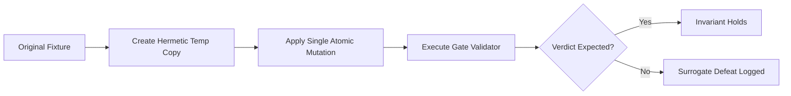

# Surrogate Verification: Why Gated Pipelines Pass Broken Work and How to Stop Them

*Written from the eleven real defects found while building the gates in this skill. Every reader
of this skill is about to write gates, so it ships with it.*

## 1. The Failure Stated Once, Plainly

Surrogate verification occurs when an automated validator inspects a proxy, a self-declaration, an unclosed blacklist, or an empty container shell instead of computing the invariant directly from ground-truth domain artifacts. The check exists, executes, exits zero, and green-lights broken work. Downstream stages consume this verdict as proof of correctness, compounding corrupted state across the pipeline. A gate that can be satisfied without the underlying property holding is not a gate; it is a promise wearing a gate's clothes. Across the build of this skill, eleven checks in seven pipeline stages passed their green test suites yet failed completely when presented with adversarial inputs—not because any check was missing, but because every single one evaluated a surrogate.

```
                              ┌──────────────────────────────────┐
                              │      Surrogate Verification      │
                              │ (The Mathematical Failure Model) │
                              └────────────────┬─────────────────┘
                                               │
         ┌─────────────────────────────────────┼─────────────────────────────────────┐
         ▼                                     ▼                                     ▼
┌───────────────────────────────┐ ┌───────────────────────────────┐ ┌───────────────────────────────┐
│            Face 1:            │ │            Face 2:            │ │            Face 3:            │
│     Self-Asserted Validity    │ │      Negative Enumeration     │ │  Vacuous Schema Satisfaction  │
│        (Self-Testimony)       │ │     (Unclosed Blacklist)      │ │(Container Presence w/o Content│
└───────────────────────────────┘ └───────────────────────────────┘ └───────────────────────────────┘
```

---

## 2. The Three Faces

Every surrogate failure observed in this build belongs to one of three structural faces. Each requires a generalising architectural remedy rather than a local patch.

### Face 1: Self-Asserted Validity (Self-Testimony)

* **The Failure**: The validator asks the artifact author or caller to state whether a property holds, branching on a declared flag, verdict token, or path override rather than evaluating the raw data structures.
* **The Build Instance**: In Stage 1, `PARTITION_KEY_UNJUSTIFIED` was designed to reject partition keys not backed by contract selectors. Injecting `"contract_derived": true` flipped the rejection into a clean pass. Similarly, `HARNESS_FIDELITY_DRIFT` passed when a `"differential_fidelity_verdict": "PARITY_CONFIRMED"` field was supplied on drifting envelopes, and the state machine's `advance` command accepted a `--from STAGE_0_DOMAIN_INGESTION` flag that overrode a contradictory recorded state.
* **The Generalising Repair**: Ban self-testimony entirely. A validator may never read an artifact's verdict on itself. Enforce this structurally with a gate script that forbids self-verdict fields in schemas and code. Derive all properties directly from ground-truth artifacts (e.g., diffing variant selectors against declared properties or comparing failure envelope arrays).
* **The Boundary**: Distinguish self-testimony from legitimate domain declarations. A property is a Face 1 defect if it is *mechanically derivable* from existing artifacts but accepted via declaration. If a property represents an extrinsic real-world fact that no prior artifact can mechanically prove (such as whether a user trigger is repeatable, or whether a blocker has actually been cleared), recording it as an explicit declaration is valid domain input.

### Face 2: Negative Enumeration (Unclosed Blacklisting)

* **The Failure**: The validator attempts to enforce correctness by enumerating known invalid tokens, patterns, or keys, rather than defining and enforcing a closed positive grammar.
* **The Build Instance**: In Stage 2, `SUPERSESSION_NOT_MATERIALISED` was checked by testing state objects against a six-name blacklist (`stale_output_resolution`, `supersession_resolution`, `supersession`, `stale_resolution`, `stale_output_mode`, `resolution`). Adding a seventh attribute, `superseded_by_mode: "DIMMED"`, bypassed the check completely. Similarly, `is_reason_meaningful` checked strings against an 8-word blacklist (`["none", "n/a", "na", "null", "undefined", "todo", "tbd", ""]`), allowing a single hyphen `"-"` or `"unneeded"` to pass as an architectural justification.
* **The Generalising Repair**: Enforce closed positive sets (`ALLOWED_STATE_KEYS`, `status in {"ADDRESSED", "NOT_APPLICABLE"}`) and set `additionalProperties: false` across schemas. In an open domain, the set of invalid expressions is infinite. Enumerating what is forbidden guarantees that unlisted invalid inputs pass undetected. Enumerate the allowed vocabulary and reject everything else.

### Face 3: Vacuous Schema Satisfaction (Container Presence Without Element Content)

* **The Failure**: The validator confirms that a container (list, map, or edge) exists or is non-empty, but fails to assert that the elements within that container satisfy domain semantics and schema constraints.
* **The Build Instance**: In Stage 1, setting `failure_envelope_census: [{}]` satisfied `EMPTY_FAILURE_ENVELOPE_CENSUS` because the check asserted only `len(census) >= 1`. In Stage 2, setting `discriminator: {"template": ""}` bypassed `MISSING_DISCRIMINATOR` because the dictionary had length 1 despite containing an empty string. In graph validation, adding a transition to `to_state: "GHOST_NON_EXISTENT_STATE"` or a self-loop `ERROR_SHOWN -> ERROR_SHOWN` satisfied state egress ($d_{out} \ge 1$) because edge endpoints were never validated against declared state vertices.
* **The Generalising Repair**: Validate element integrity, recursive value schemas, and relational referential integrity. Never treat container cardinality as a proxy for semantic fulfillment. Require that every list item conforms to a strict sub-schema with non-empty values, and verify foreign-key references against closed vertex sets before evaluating topological invariants.

---

## 3. The Fourth Candidate Resolved: The Duplicated Helper

During Stage 2 evaluation, `BRANCH_INAPPLICABLE_UNREASONED` was defeated by `inapplicable_reason: "-"` an hour after `is_reason_meaningful` had been remediated in Stage 1. The Stage 2 validator had its own copy-pasted implementation of the helper, retaining the unclosed blacklist.

### Is This a Fourth Face?

**No. It is an architectural failure of the codebase (Fragmented Gate Authority / Copy-Paste Decay), not a distinct mode of check failure.**

At the check level, the failure mode was purely **Face 2 (Negative Enumeration)**. Duplicating code does not create a new category of logical flaw; it creates multiple independent vectors for an existing flaw to survive remediation.

### The Supervisor's Own Error as Definitive Evidence

The distinction was demonstrated mechanically when the build's supervisor attempted to prevent recurrence of an earlier mistake — closing a task while its worker's completion was refused. The supervisor wrote a wrapper script and inside it grepped completion output for `refus|error|missing`. The script immediately threw a false refusal on a valid handoff containing the case identifier `s2-missing-discriminator-empty-values`.

The supervisor committed **Face 2 (keyword blacklisting over open text)** inside the tool built to catch **Face 1 (trusting procedural state without reading the verdict)**.

This is definitive evidence for the taxonomy:
1. The **three faces** describe universal failure modes of verification logic, appearing identically in Python validators, JSON schemas, shell scripts, and supervisory automation.
2. **Codebase duplication** describes how checks decay across an application when validation primitives are not centralized into a single authoritative library (`skills/<skill>/lib/`).

---

## 4. How to Tell Before You Ship

A reviewer assessing a check must ask one sharpened question:

> **"What artifact is this answer computed from, and what is the minimum synthetic payload an author or model could write to make it pass without satisfying the property?"**

If the answer is a boolean flag, an unlisted keyword, or an empty dictionary shell, the gate is a surrogate.

```
┌───────────────────────────────────┬────────────────────────────────────────────────────────────────────────┐
│ Code Smell / Tell                 │ Underlying Face & Failure Mode                                         │
├───────────────────────────────────┼────────────────────────────────────────────────────────────────────────┤
│ `if data.get("is_valid"):`        │ Face 1 (Self-Testimony): Trusting author assertions over computation. │
│ `args.from_state or state[...]`   │ Face 1 (Self-Testimony): Allowing CLI arguments to override artifacts.│
│ `if val not in BLACKLIST:`        │ Face 2 (Negative Enumeration): Open domain evaluated with blacklist.   │
│ Missing `additionalProperties`    │ Face 2 (Negative Enumeration): Schema allows arbitrary bypass keys.    │
│ `if len(container) > 0:`          │ Face 3 (Vacuous Satisfaction): Cardinality checked without contents.   │
│ `t["from_state"] in states`       │ Face 3 (Vacuous Satisfaction): Topological checks missing foreign keys.│
└───────────────────────────────────┴────────────────────────────────────────────────────────────────────────┘
```

---

## 5. The Method That Found Them

The eleven defects were uncovered using an adversarial mutation loop: **mutate one property that should not change the verdict (or alter an invalid fixture into an alternative invalid shape) in an isolated copy, and re-run.**



### Why One Thing at a Time
Mutating multiple properties simultaneously obscures causal attribution. If a modified fixture fails, the reviewer cannot tell whether the intended check caught it or an unrelated schema validator aborted execution early. Single-variable mutations isolate the exact boundary conditions of the check.

### Why in a Throwaway Copy
Gates must be strictly hermetic and idempotent. Early in this build, the test runner executed the state machine's `advance` command in place. The command wrote the updated state back to the fixture's own state file. Run 1 passed; run 2 failed because `STAGE_1 -> STAGE_1` was an illegal transition. The gate's verdict depended entirely on execution count. Hermetic sandbox copies ensure tests never pollute test fixtures.

### Why the Author Cannot Attack Their Own Check
An author writes tests based on the same cognitive assumptions that produced the validator. In this build, eleven defects slipped past green test suites written by the same worker because the worker's test fixtures satisfied the author's mental model. An independent evaluator operates with an adversarial mandate: prove the gate is a liar by constructing the minimal bypass.

### The Operational Boundary
In locked-down agent fleets, workers may lack permissions to execute arbitrary scripts under default-deny policies. The split adopted here—one agent **designs** the adversarial mutations and commits them as a durable harness, while the supervisor **executes** the harness and records measurements—creates a permanent, repeatable audit trail of gate resilience.

---

## 6. What It Cost, Honestly

Adversarial surrogate verification is expensive. On this build, the price was:
* **Two full evaluator passes** (Pass 1 covering the scaffold, Stage 0 and Stage 1; Pass 2 covering Stage 2).
* **Three dedicated remediation rounds.**
* **Roughly one-third of the total task budget** consumed solely by adversarial probing and remediation.

### Was It Worth It?

**Yes, because the defects were foundational.**

The eleven caught defects were not stylistic flaws; they were total bypasses of state machines, partition mathematics, and graph traversals. In a multi-stage agentic pipeline, a defect allowed past Stage 1 corrupts the inputs to Stages 2 through 5. Fixing a state machine bypass at Stage 5 requires refactoring all downstream dependents and invalidating generated artifacts. Eliminating them early preserved the integrity of the entire downstream build.

### When to Skip It

Adversarial verification is an architectural investment, not a universal requirement.

```
                       ┌───────────────────────────────┐
                       │  Is the component a critical  │
                       │ gatekeeper, state machine, or │
                       │    orchestration boundary?    │
                       └───────────────┬───────────────┘
                                       │
                        ┌──────────────┴──────────────┐
                        ▼                             ▼
                     [ YES ]                       [ NO ]
                        │                             │
        ┌───────────────┴───────────────┐             │
        │ Run Adversarial Mutation Pass │             │
        │  • Enforce Closed Grammars    │             │
        │  • Forbid Self-Testimony      │             │
        │  • Deep Element Validation    │             │
        └───────────────────────────────┘             │
                                                      ▼
                                       ┌──────────────────────────────┐
                                       │    SKIP ADVERSARIAL PASS     │
                                       │ • Use Standard Unit Tests    │
                                       │ • Rely on Fast Feedback Loops│
                                       └──────────────────────────────┘
```

* **SKIP IT WHEN**:
  * Writing leaf features, UI layouts, presentation templates, or formatting scripts.
  * Building throwaway prototypes, exploratory spikes, or short-lived CLI utilities.
  * The blast radius of a failure is local, non-cascading, and immediately visible to a human.
* **NEVER SKIP IT WHEN**:
  * Building quality gates, schema validators, state machine transitions, or admission controllers.
  * Autonomous sub-agents consume gate verdicts as ground truth to execute subsequent code changes.
  * Multi-stage pipelines rely on upstream invariants to prevent unconstrained cascading generation errors.
