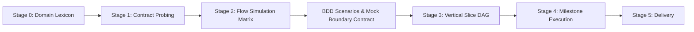
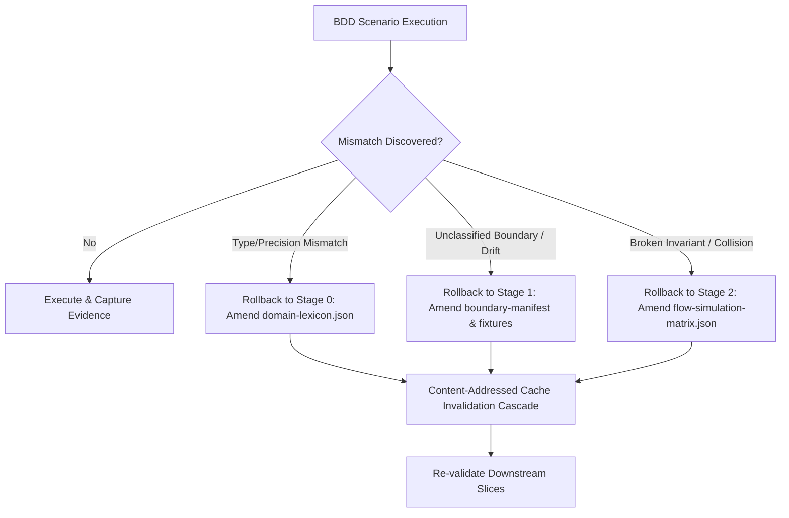

# BDD Scenario & Mock-Boundary Contract Specification

**Stage:** `STAGE_2_SCENARIO_SIMULATION` / `STAGE_4_MILESTONE_EXECUTION`  
**Owner:** `stage-2` / `stage-4` / `bdd-scenario-tester`  
**Schema:** `schemas/bdd-scenario.schema.json`  
**Validator Tool:** `bin/validate-bdd-contracts`  
**Engine:** `lib/bdd_scenario.py`, `lib/rollback.py`  
**Reference Examples:** `examples/bdd-scenarios/`  

---

## 1. Scenario Derivation & Phasing

Executable BDD scenarios form the formal verification bridge between **Stage 2 Flow Simulation** and **Stage 4 Milestone Execution**:



### Derivation Rules
1. **Branch Class Derivation**: Every scenario is derived directly from a specific transition in `flow-simulation-matrix.json` and linked to a canonical **Branch Class Group A** (Resource & State) or **Group B** (Trigger & Observation) taxonomy.
2. **Deterministic Preconditions & Postconditions**: Initial state tokens in `given` and resulting state tokens in `then` map 1:1 to states modeled in the Stage 2 simulation graph.
3. **Fixture Binding**: External boundary expectations in `given.fixture_presets` map directly to verified recorded responses in `contract-fixtures/`.

---

## 2. Scenario Structure & Specification

BDD scenarios adhere to the formal JSON schema `schemas/bdd-scenario.schema.json`:

### Given: Domain State & Verified Fixture Presets
- **`state_token`**: Initial domain state token (e.g. `ORDER_DRAFTED`, `IDLE`).
- **`entity_states`**: Domain entity instances with attribute values locked to unit precisions defined in `domain-lexicon.json`.
- **`datastore_state`**: Baseline database state or seeded records for the real datastore.
- **`fixture_presets`**: Active bindings of external boundaries to recorded contract fixture samples (`boundary_identifier`, `sample_id`, `fixture_path`).

### When: Real Production Entrypoint Invocation
- **`entrypoint_type`**: `CLI_COMMAND` | `HTTP_HANDLER` | `MESSAGE_CONSUMER` | `FUNCTION_CALL`.
- **`invoked_target`**: The real production entrypoint symbol, CLI command, route, or topic (e.g. `POST /v1/orders`, `bin/purge-cancelled-orders`).
- **`actor_id`**: The registered domain actor initiating the trigger.
- **`action_token`**: The domain action token triggering the execution.
- **`payload` / `command_args` / `headers`**: Input parameters supplied directly to the production entrypoint.

### Then: State Assertions, Projections & Events
- **`state_token`**: Resulting domain state token (e.g. `ORDER_CONFIRMED`, `VALIDATION_REJECTED`).
- **`state_assertions`**: Concrete assertions on domain entity mutations and invariant guarantees.
- **`observer_projections`**: Perceived outputs across the 6 verification media (`rendered_ui`, `api_response`, `process_exit`, `datastore_state`, `device_actuation`, `agent_transcript`) with discriminator patterns and declared projection quantities.
- **`event_emissions`**: Domain events and audit records emitted to messaging topics.

---

## 3. Strict Mock-Boundary Isolation Contract

To prevent mock-to-reality divergence, the pipeline enforces strict boundary isolation:

```
+-------------------------------------------------------------------------+
|                         REAL PRODUCTION EXECUTION                       |
|  +---------------------+  +----------------------+  +----------------+  |
|  |   Domain Entities   |  |   Validation Engine  |  | State Machine  |  |
|  +---------------------+  +----------------------+  +----------------+  |
|  +---------------------+  +----------------------+  +----------------+  |
|  |     Pure Modules    |  | Business Logic Rules |  | Real Datastore |  |
|  +---------------------+  +----------------------+  +----------------+  |
+-------------------------------------------------------------------------+
                                    |
                        [External Boundary Only]
                                    v
+-------------------------------------------------------------------------+
|                    VERIFIED CONTRACT FIXTURE REPLAY                     |
|  +-------------------------------------------------------------------+  |
|  | ONLY external boundaries declared PRESENT in boundary-manifest    |  |
|  | MUST replay recorded samples from contract-fixtures/              |  |
|  | Ad-hoc or unverified mock responses: STRICTLY PROHIBITED          |  |
|  +-------------------------------------------------------------------+  |
+-------------------------------------------------------------------------+
```

### Mandatory Rules
1. **Forbidden Internal Mocks (`FORBIDDEN_INTERNAL_MOCK`)**:
   Domain entities, business logic, validation engines, state machines, and pure modules must never be mocked or replaced with stubs. They must execute real production code.
2. **Verified External Boundaries Only (`UNVERIFIED_MOCK_BOUNDARY`)**:
   Only external boundaries declared as `PRESENT` in `boundary-manifest.json` may be mocked.
3. **Fixture Replay Enforcement (`UNVERIFIED_FIXTURE_REPLAY`)**:
   All mock responses must replay recorded samples from `contract-fixtures/`. Ad-hoc, synthetic, or hand-rolled mock responses outside verified contract fixtures are rejected.

---

## 4. Interface Discovery & Upstream Refactoring Loop

When authoring or executing BDD scenarios, new domain requirements or interface mismatches trigger deterministic upstream feedback loops:



### Static Discovery Rejection Codes
- **`UNDEFINED_STATE_TOKEN`**: Scenario references a state token not declared in Stage 2 simulation or Stage 0 lexicon.
- **`UNDEFINED_DOMAIN_ACTION`**: Scenario references an action or trigger token not registered for the actor.
- **`UNBOUND_PROJECTION_QUANTITY`**: Scenario references a projection quantity not bound in `domain-lexicon.json`.

### Runtime Rollback Routing via `lib/rollback.py`
| Observed Failure Cause | Upstream Stage Target | Required Action |
| :--- | :--- | :--- |
| `DOMAIN_TYPE_PRECISION_MISMATCH` | `STAGE_0_DOMAIN_INGESTION` | Amend `domain-lexicon.json` with correct unit precision / numeric type. |
| `BROKEN_INVARIANT` / `FINGERPRINT_COLLISION` | `STAGE_2_SCENARIO_SIMULATION` | Amend `flow-simulation-matrix.json` with missing states or refined discriminators. |
| `UNCLASSIFIED_BOUNDARY` / `CONTRACT_DRIFT` | `STAGE_1_CONTRACT_PROBING` | Amend `boundary-manifest.json` and re-probe live boundary to update `contract-fixtures/`. |

### Content-Addressed Cache Cascade
When upstream artifacts are modified, `compute_upstream_cache_digest` computes SHA-256 digests across `domain-lexicon.json`, `boundary-manifest.json`, and `flow-simulation-matrix.json`. Any digest change invalidates dependent slice execution caches, guaranteeing that stale test runs are never reused.

---

## 5. Reference Scenarios Catalog

Four canonical reference scenarios are provided in `examples/bdd-scenarios/`:

1. **Success Flow (`success-flow.json`)**:
   Full order creation and payment authorization flow verifying domain state transition to `ORDER_CONFIRMED`, locked unit precisions, and dual-observer projections (`api_response` and `rendered_ui`).
2. **Validation Failure (`validation-failure.json`)**:
   Input validation rejection on invalid item quantity transitioning to `VALIDATION_REJECTED` without invoking external boundaries.
3. **External Boundary Failure (`external-boundary-failure.json`)**:
   External payment gateway timeout (HTTP 504) triggering retryable suspension (`PAYMENT_RETRYABLE_SUSPENDED`) and operational alert emission.
4. **Lifecycle Delete/Cleanup (`lifecycle-delete-cleanup.json`)**:
   CLI command purging expired cancelled orders, releasing resource locks, and confirming zero resource leaks.
