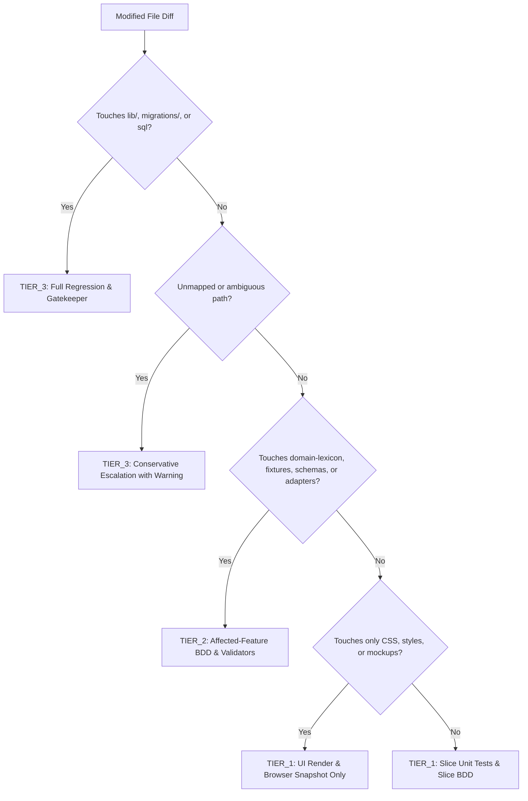

# Risk- and Impact-Based Verification Policy & Escalation Rules

**Stage:** `STAGE_4_MILESTONE_EXECUTION` / `STAGE_5_DELIVERY`  
**Owner:** `stage-4` / `stage-5`  
**Schema:** `schemas/verification-plan.schema.json`  
**Engine:** `lib/verification_policy.py`, `lib/sidecar.py`  
**Validators:** `bin/planner-state verification-plan`, `bin/milestone-harness`

---

## 1. Overview & Verification Objectives

Executing monolithic test suites across every granular slice edit introduces severe token latency, wasted worker compute, and cognitive clutter. Conversely, unconstrained test skipping risks silent regressions, contract drift, and mock-to-reality divergence.

This policy defines a **deterministic, risk- and impact-based verification hierarchy** with three execution tiers:
1. **Tier 1 (Slice-Local)**: Rapid inner-loop verification of slice-specific pure logic, UI render checks, and targeted BDD scenarios.
2. **Tier 2 (Affected-Feature)**: Feature-wide boundary verification across all feature BDD scenarios, domain schema validators, and projection verifiers.
3. **Tier 3 (Full-Suite & Gatekeeper)**: Full regression suite execution, adversarial surrogate refutation, Playwright headless UI observation, and stage delivery gatekeepers.

---

## 2. Three-Tier Verification Execution Model

| Tier | Name | Target Scope | Trigger Conditions | Executed Check Categories | Bypassed Suites (with Reason Code) |
| :--- | :--- | :--- | :--- | :--- | :--- |
| **Tier 1** | **Slice-Local** | Inner-loop slice development & UI layout | Pure UI/CSS edits, slice pure modules, slice entrypoints, slice unit tests | `unit_test`, `bdd_scenario`, `linter`, `render_check`, `browser_snapshot` | Backend integration & adversarial fuzzing (`SKIP_UI_ONLY`), monolithic regression (`SKIP_SLICE_LOCAL_SUFFICIENT`) |
| **Tier 2** | **Affected-Feature** | Feature-wide domain & boundary integration | Entity schemas, domain lexicon, contract fixtures, state machines, external adapters | `unit_test` (feature-wide), `bdd_scenario` (all feature scenarios), `stage_validator`, `projection_verifier` | Multi-feature global gatekeeper suites (`SKIP_FEATURE_SCOPED`), global adversarial fuzzing (`SKIP_FEATURE_SCOPED`) |
| **Tier 3** | **Full-Suite & Gatekeeper** | Monolithic regression, adversarial integrity, & stage exit | Core shared libraries (`lib/`), migrations, multi-slice primitives, Stage 5 delivery exit, unmapped diffs | `regression_suite`, `adversarial_check`, `stage_validator`, `gatekeeper`, `ui_observation` | **None** (Full suite execution mandatory) |

---

## 3. Deterministic Trigger Matrix & Diff Classification

File diff paths are categorized using deterministic path pattern matching:



### Concrete Diff Examples and Classification

#### Example 1: Pure UI / CSS / Layout Changes
* **Modified Files:**
  ```
  styles/main.css
  components/search-results.module.css
  ui/mockups/search-results.html
  ```
* **Determined Tier:** `TIER_1`
* **Selected Checks:**
  - `bin/render-ui-mockup --feature search-ui` (`render_check`)
  - `bin/observe-rendered-ui --feature search-ui --target mockups/search-results.html` (`browser_snapshot`)
* **Skipped Checks:**
  - `backend_integration_suite` with citation `SKIP_UI_ONLY` ("Pure UI styling and layout modifications do not touch backend business logic or data contracts.")
  - `adversarial_fuzz_checks` with citation `SKIP_UI_ONLY` ("CSS and layout changes are isolated from API failure envelopes and adversarial contract boundaries.")

#### Example 2: Slice Business Logic & Entrypoint Changes
* **Modified Files:**
  ```
  src/slices/query/query_filter.py
  tests/unit/test_query_filter.py
  ```
* **Determined Tier:** `TIER_1`
* **Selected Checks:**
  - `pytest tests/unit/slice_query -q` (`unit_test`)
  - `pytest tests/bdd/test_slice_query.py -q` (`bdd_scenario`)
  - `flake8 src/slices/query tests/unit/test_query_filter.py` (`linter`)
* **Skipped Checks:**
  - `monolithic_regression_suite` with citation `SKIP_SLICE_LOCAL_SUFFICIENT` ("Slice modifications are fully encapsulated within local pure modules and covered by slice-specific test suites.")
  - `adversarial_redteam_suite` with citation `SKIP_SLICE_LOCAL_SUFFICIENT` ("Global adversarial security probes are deferred to Stage 5 delivery exit gating.")

#### Example 3: Domain Schema, Lexicon, or Contract Fixtures
* **Modified Files:**
  ```
  domain-lexicon.json
  contract-fixtures/search-api/manifest.json
  adapters/search_adapter.py
  ```
* **Determined Tier:** `TIER_2`
* **Selected Checks:**
  - `pytest tests/unit/ -q` (`unit_test`)
  - `pytest tests/bdd/ -q` (`bdd_scenario`)
  - `python3 bin/validate-lexicon domain-lexicon.json` (`stage_validator`)
  - `python3 bin/validate-scenario-matrix flow-simulation-matrix.json` (`stage_validator`)
  - `python3 bin/verify-projections projections.json flow-simulation-matrix.json` (`projection_verifier`)
* **Skipped Checks:**
  - `multi_feature_cross_system_gatekeeper` with citation `SKIP_FEATURE_SCOPED` ("Modifications are strictly contained within feature boundaries; global multi-feature gatekeeper suites are reserved for delivery exit.")

#### Example 4: Core Shared Libraries & Datastore Migrations
* **Modified Files:**
  ```
  lib/primitives.py
  migrations/0003_add_session_tenant_index.sql
  ```
* **Determined Tier:** `TIER_3`
* **Selected Checks:**
  - `pytest tests/ -q` (`regression_suite`)
  - `python3 tests/test_surrogate_verification.py` (`adversarial_check`)
  - `python3 bin/milestone-harness .verified-feature-delivery/search-ui` (`gatekeeper`)
  - `python3 bin/verify-evidence .verified-feature-delivery/search-ui` (`gatekeeper`)
* **Skipped Checks:** None (Tier 3 mandates full suite execution).

#### Example 5: Stage 5 Delivery Exit
* **Context:** Pipeline advancing from `STAGE_5_DELIVERY` to `COMPLETED` or running Stage 5 exit verification.
* **Determined Tier:** `TIER_3` (`mandatory_gatekeeper: true`)
* **Selected Checks:**
  - Full regression test suite (`regression_suite`)
  - Adversarial red-team measurement suite (`adversarial_check`)
  - Milestone harness validation (`gatekeeper`)
  - Stage 5 evidence verification (`gatekeeper`)
  - Headless browser Playwright observation (`ui_observation`)
* **Skipped Checks:** None. Bypassing gatekeeper checks at Stage 5 exit is strictly refused.

#### Example 6: Ambiguous / Unmapped Diff
* **Modified Files:**
  ```
  scripts/custom_deploy_patch.sh
  config/experimental_flags.conf
  ```
* **Determined Tier:** `TIER_3` (**Conservative Escalation**)
* **Recorded Warnings:**
  - `"Unmapped path or ambiguous dependency detected: 'scripts/custom_deploy_patch.sh'. Conservatively escalating verification execution to TIER_3."`
  - `"Unmapped path or ambiguous dependency detected: 'config/experimental_flags.conf'. Conservatively escalating verification execution to TIER_3."`
* **Selected Checks:** Full regression, adversarial suites, and gatekeeper verifiers.

---

## 4. Skip Auditing & Substantive Reason Rules

Every bypassed test suite must be explicitly documented in the verification plan under `skipped_checks`. A skipped check record requires:
1. `suite_name`: Identifier of the bypassed test suite.
2. `reason_code`: Standardized citation enum:
   - `SKIP_UI_ONLY`
   - `SKIP_SLICE_LOCAL_SUFFICIENT`
   - `SKIP_FEATURE_SCOPED`
   - `SKIP_NON_OBSERVABLE`
   - `SKIP_NOT_APPLICABLE`
3. `reason_description`: Meaningful justification prose meeting the non-vacuous requirement:
   - Must contain at least 3 words.
   - Must contain at least 8 letters.
   - Letters must constitute at least 50% of non-whitespace characters.

Plans with vacuous, missing, or unauthorized skip reasons are rejected with `VERIFICATION_PLAN_INVALID`.

---

## 5. Worker Sidecar Integration Protocol

When the driver dispatches a worker via `bin/planner-state sidecar --feature <slug> --slice <slice_id>`, the sidecar artifact (`sidecars/<slice_id>.json`) embeds the computed `verification_plan`.

Workers read the embedded `verification_plan` and execute **only** the commands listed in `selected_checks`. This guarantees:
- Worker agents do not waste hundreds of seconds running unrelated monolithic test suites on simple slice edits.
- Workers do not invent arbitrary verification commands or skip essential validation steps.
- The evaluation capsule returned by the worker reflects exact compliance with the selected tier.
